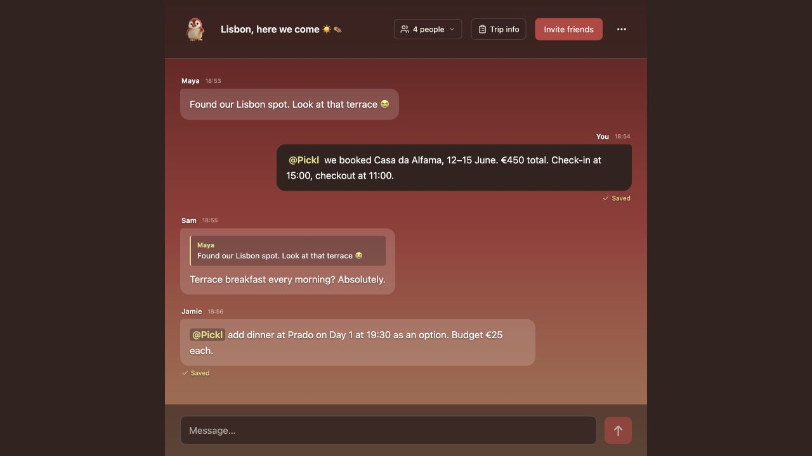
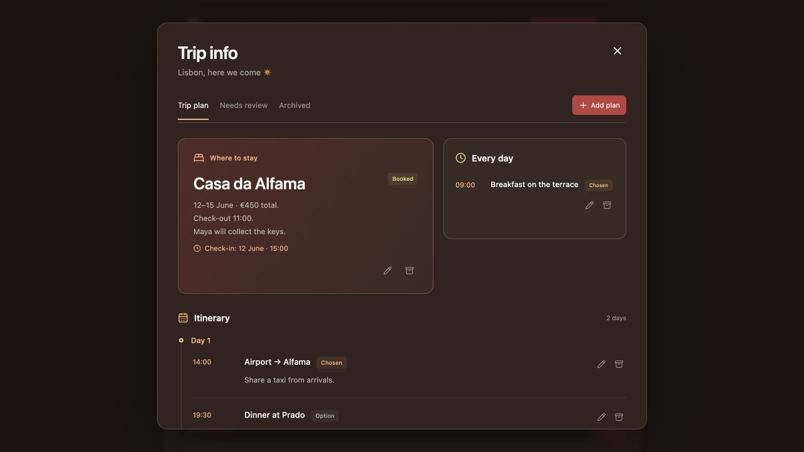

# Pickl — holiday planning for you and your unorganised friends

A group chat that turns holiday ideas into a shared trip plan. Start a chat, invite your friends, and tag `@Pickl` to save a place, decision or booking. No ChatGPT sign-in required.

## Screenshots

|  |  |

## How it works

- Tag `@Pickl` to create, update or archive plans. Trip info groups stays, daily activities, trip-wide routines and ideas; everything is editable.
- **Option** means suggested, **Chosen** means decided, and **Booked** means someone reported a completed booking. Only unclear or conflicting instructions need review.
- Pickl stays out of the conversation: no chat replies or booking actions. Banter saves nothing and may get a deadpan penguin reaction.
- Rename groups, view participants, quote replies and return through recent chats. The creator can delete a group.

Only members can access a chat. Invite links grant membership after a display name is entered; names are unverified. Clearing cookies loses that browser identity—use an invite to rejoin. The chat displays the latest 300 messages.

## Run locally

Requires Node 22.13+ and npm. Put `OPENAI_API_KEY` in an ignored `.dev.vars` file. Optional `OPENAI_MODEL` defaults to `gpt-5-mini`.

```sh
npm ci
npm run build
node --import ./scripts/sites-env.mjs ./node_modules/wrangler/bin/wrangler.js d1 migrations apply DB --local --config dist/server/wrangler.json --persist-to .wrangler/state
npm run dev
```

Open the printed URL, normally `http://127.0.0.1:5173`. Keep the same hostname to retain your session. Apply pending migrations before running an updated version; do not manually replay applied SQL. Local and hosted databases are separate.

## AI and hosting

Runs on Sites with Cloudflare Workers and D1. Set hosted API keys through Sites secrets; never commit credentials or expose them in browser code.

Only tagged instructions, quoted context and a bounded set of saved plans go to OpenAI (`store: false`). Ordinary chat is not sent, links are not fetched, and history is not automatically reprocessed. Messages save before AI runs; failed captures can be retried or added manually. Version checks protect concurrent edits.

AI limits: 30 requests per guest/hour, 200 per trip/day and 1,000 per site/day, including failures. Guest identities are unverified, so these are initial spending safeguards.

## Checks

```sh
node --experimental-strip-types --test app/*.test.ts
npx tsc --noEmit
npm run build
```

Optional live AI checks: `node --experimental-strip-types scripts/eval-review.ts` (uses the configured key and incurs API costs).
